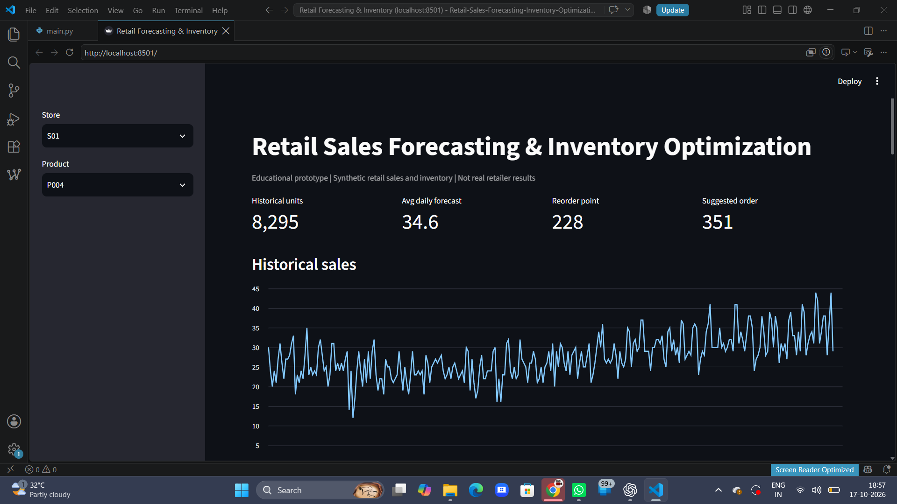
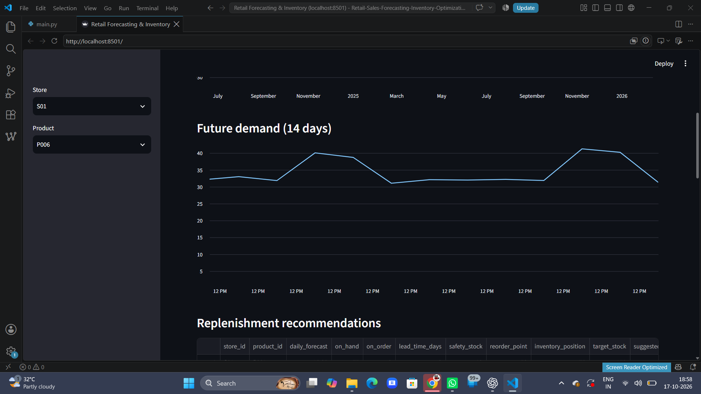
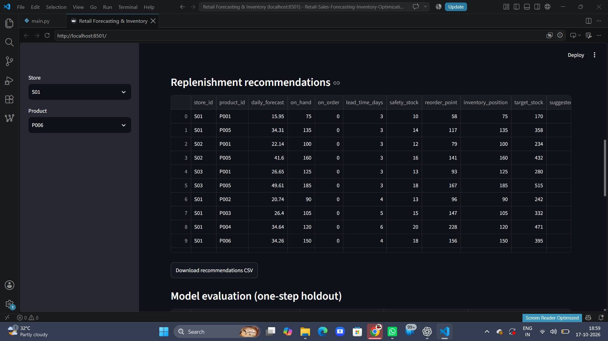
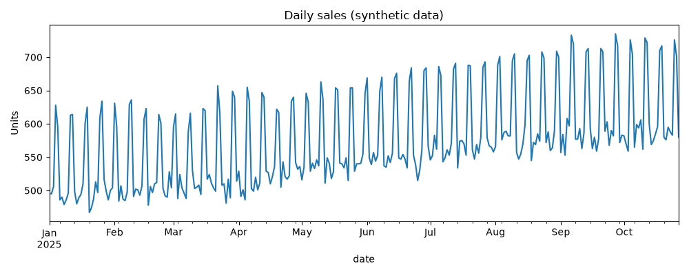
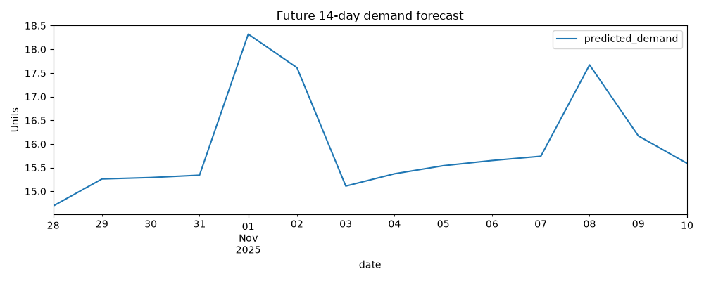

# Retail Sales Forecasting & Inventory Optimization

**End-to-end Python and machine learning portfolio project | Synthetic retail data | Forecasting • Replenishment • Simulation • Streamlit**

> **Transparency:** This is an educational prototype using synthetic data and simulated supplier/inventory information. The results are not from a real retailer and do not demonstrate verified financial savings.

## Project overview

This project forecasts daily demand for products at multiple retail stores and converts predictions into **inventory planning recommendations**. It combines reproducible data generation, data quality checks, exploratory analysis, leakage-aware feature engineering, baseline and ML forecasting, safety stock and reorder-point calculations, a virtual inventory simulation, and a Streamlit dashboard.

**At a glance:** 3 stores × 6 products × 300 historical days = **5,400 synthetic records**; 14-day future forecast for 18 store–product combinations = **252 forecast rows**.

## Business problem and industry relevance

Retailers face competing risks: **stockouts** (unmet customer demand) and **overstock** (capital tied up in inventory). Demand changes across products, stores, weekdays, and seasons. A useful planning workflow should estimate future demand, consider supplier lead time, and recommend when and how much to replenish.

**Potential business value:** earlier visibility into expected demand, consistent replenishment decisions, clearer stockout-versus-holding-cost trade-offs, and auditable planning outputs. These are *intended uses*, not measured benefits at a real business.

## Tech stack

| Area | Tools |
|---|---|
| Language | Python 3.11 |
| Data processing | pandas, NumPy |
| Forecasting | scikit-learn (Linear Regression, Random Forest); seasonal naive baseline |
| Visualizations | matplotlib, seaborn, Plotly |
| Dashboard | Streamlit |
| Model persistence | joblib |
| Testing | pytest |
| Development | VS Code, Git, GitHub |

## System architecture

```text
Synthetic historical sales + simulated inventory/suppliers
                         |
                         v
               Data validation & cleaning
                         |
                         v
          Lag, rolling, calendar features
                         |
                         v
    Chronological holdout model comparison
   (seasonal naive / linear / random forest)
                         |
                         v
              14-day demand forecasts
                         |
             +-----------+-----------+
             |                       |
             v                       v
    Reorder recommendations    Inventory policy simulation
    (safety stock, ROP,        (fixed vs forecast-driven,
     inventory position)        illustrative comparison)
             |                       |
             +-----------+-----------+
                         v
                 CSV reports & charts
                         |
                         v
                  Streamlit dashboard
```

See [`docs/architecture.md`](docs/architecture.md) and [`docs/methodology.md`](docs/methodology.md).

## Repository structure

```text
├── .github/workflows/tests.yml    # Automated test workflow
├── app/dashboard.py               # Streamlit interface
├── data/sample/sample_sales.csv   # Small tracked example
├── docs/                          # Architecture, dataset, methods, limitations
├── images/charts/                 # Generated charts included as examples
├── images/dashboard/              # Add your dashboard screenshots here
├── models/                        # Local trained model files (ignored)
├── notebooks/                     # Reserved for future analysis notebooks
├── outputs/                       # Local forecasts and simulations (ignored)
├── reports/                       # Evaluation and business notes
├── src/                           # Data, features, models, inventory, simulation
├── tests/                         # Unit tests
├── .gitignore
├── main.py                        # Command-line pipeline
├── pyproject.toml
└── requirements.txt
```

`data/raw/`, `data/processed/`, `data/simulated/`, `.venv/`, and generated model/output files are ignored by Git. Regenerate these locally using the commands below.

## Installation — Windows / VS Code

**Prerequisites:** Python 3.11 and Git installed.

```powershell
git clone https://github.com/YOUR_USERNAME/retail-sales-forecasting-inventory-optimization.git
cd retail-sales-forecasting-inventory-optimization
python -m venv .venv
.\.venv\Scripts\Activate.ps1
python -m pip install -r requirements.txt
python -m pip check
```

Replace `YOUR_USERNAME` with your GitHub username after publishing. If PowerShell blocks activation, open a **Command Prompt** terminal and run `.venv\Scripts\activate.bat`.

## Run the complete project

```powershell
python main.py all
python -m pytest -q
python -m streamlit run app/dashboard.py
```

Open the local URL printed by Streamlit (usually `http://localhost:8501`). To run stages individually:

```powershell
python main.py generate
python main.py preprocess
python main.py train
python main.py forecast
python main.py inventory
python main.py simulate
```

`generate` creates/replaces synthetic inputs; `all` only generates them if the raw sales file is missing.

## Synthetic dataset and simulation

- **Entities:** `store_id`, `product_id`, product category, daily date, units demanded/sold, and unit price; supplier and inventory tables are generated separately.
- **Demand generation:** baseline store/product differences, weekends, yearly seasonal variation, gradual trend, and random noise.
- **Model inputs:** calendar features, historical lags, and shifted rolling demand averages.
- **Forecasting:** chronological 28-day one-step holdout comparison; retraining on history; recursive 14-day forecast.
- **Inventory planning:** safety stock, reorder point, inventory position, and suggested order quantities.
- **Simulation:** identical synthetic demand is used to compare a fixed-rate and forecast-based replenishment policy. Daily deliveries, sales, lost demand, and closing stock are recorded.
- **Visualization:** sales history, holdout predictions, future forecast, policy comparison, and interactive store/product selection.

### Inventory formulas

- Safety stock: `SS = Z × σ_daily × √lead_time_days`
- Reorder point: `ROP = mean_daily_demand × lead_time_days + SS`
- Inventory position: `on_hand + on_order − backorders`
- Suggested order: when `inventory_position ≤ ROP`, `max(0, target_stock − inventory_position)`; otherwise `0`.

These are simplified assumptions, not universally optimal purchasing rules.

## Illustrative results

**One-step chronological holdout (synthetic data):**

| Model | MAE | RMSE | WAPE |
|---|---:|---:|---:|
| Random Forest | **2.8073** | **3.4543** | **8.14%** |
| Linear Regression | 3.0378 | 3.7329 | 8.81% |
| Seasonal Naive | 3.5833 | 4.4163 | 10.39% |

**Selected model in the included run:** Random Forest. These numbers are **not** validated 14-day recursive forecasting errors.

**Illustrative policy simulation (synthetic demand):**

| Metric | Fixed policy | Forecast policy |
|---|---:|---:|
| Fill rate | 98.9% | 100.0% |
| Stockout days | 1 | 0 |
| Lost units | 5 | 0 |
| Average closing stock | 57.36 | 61.68 |
| Holding cost (simulated units) | 160.60 | 172.70 |

The forecast policy reduced lost demand in this single scenario but held more inventory. The simulation reuses the model-selection holdout and is **not an unbiased estimate of improvement**.

## Screenshots and demo

Add your own evidence to `images/dashboard/`, then keep these image links (or adjust filenames to match your files):

### Dashboard overview


### Forecast and reorder recommendations



### Simulation comparison


### Generated charts



**Demo video:** [https://youtu.be/JDMo5V8n_es](DEMO_VIDEO_LINK_HERE)

> **Before publishing:** Replace `DEMO_VIDEO_LINK_HERE` with an actual public video link, or remove the demo-video line until the recording is uploaded. Add the screenshot files under the exact names above, or update the links.

## Key outputs

| Output | Local path |
|---|---|
| Cleaned sales | `data/processed/clean_sales.csv` |
| Model evaluation | `reports/model_scores.csv` |
| 14-day forecast | `outputs/forecasts/future_forecast.csv` |
| Replenishment recommendations | `outputs/inventory/reorder_recommendations.csv` |
| Daily simulation | `outputs/simulation/simulation_daily.csv` |
| Policy comparison | `outputs/simulation/policy_comparison.csv` |

Generated CSVs are kept local by `.gitignore` to avoid bloating the repository; they can be recreated by running the pipeline.

## Testing

```powershell
python -m pytest -q
```

The starter test suite covers basic data validation, feature creation, forecasting, inventory calculations, and simulation behavior. Additional edge-case and integration tests remain future work.

## Limitations and future improvements

1. Replace synthetic inputs with a documented public dataset and clear licensing/attribution.
2. Evaluate multi-step forecasting with **rolling-origin backtesting** and a separate untouched test period.
3. Separate model selection from inventory-policy evaluation to reduce optimistic bias.
4. Integrate the safety-stock reorder policy into the simulator itself.
5. Model variable supplier lead times, minimum order quantities, delivery schedules, and spoilage.
6. Estimate financial trade-offs with clearly documented costs and service-level targets.
7. Add a public hosted dashboard and automated data validation/reporting.

For more detail, read [`docs/limitations.md`](docs/limitations.md).

## Learning outcomes

- Built a modular Python data/ML pipeline and interactive dashboard.
- Practiced cleaning, lag features, chronological evaluation, and baseline comparisons.
- Applied safety stock, reorder-point, and order-up-to inventory concepts.
- Used a controlled simulation to study stockouts versus inventory holding costs.
- Learned reproducible project setup, testing, documentation, and Git/GitHub workflows.

## Author

**Mohit Pimpalkar**  
Computer Engineering student | Python • Machine Learning • Data Analytics  
GitHub: `https://github.com/mohitpimpalkar27-ctrl`  
LinkedIn: `in/mohit-pimpalkar`

---

*Educational portfolio project. Synthetic data and simulated outcomes; not financial or operational advice.*
